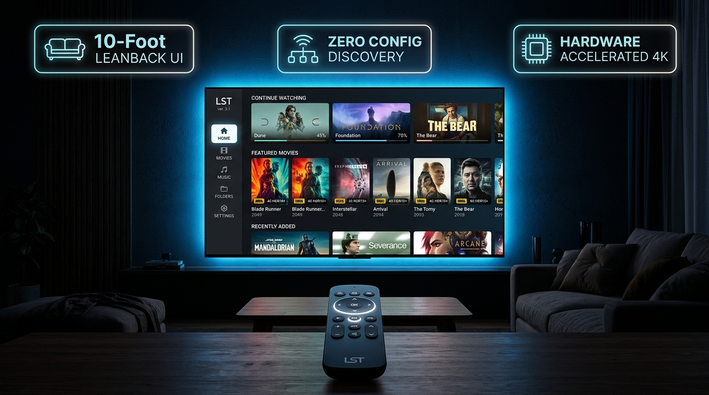
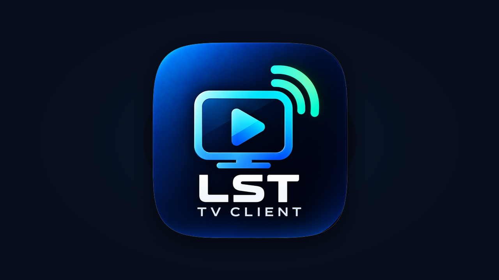

# LST TV Client — Android TV & Google TV Media Player

[](https://developer.android.com/tv)
[](https://kotlinlang.org)
[](https://developer.android.com/media/media3)
[-orange)](#prerequisites)
[-brightgreen)](#prerequisites)
[](#10-foot-television-experience)

**LST TV Client** is a native, high-performance Android TV and Google TV application engineered specifically for the 10-foot living room experience. It seamlessly connects to your **Local Media Server** running on your local Wi-Fi or mobile hotspot network, allowing you to browse, stream, and enjoy your movies, shows, lossless music, and photos with zero cloud dependency.

Built from the ground up for television remotes, LST TV Client delivers fluid D-pad navigation, instant zero-configuration server discovery, HTTP 206 byte-range hardware-accelerated streaming, seamless external player integration, and playback resume memory.

---

## Key Highlights

- **Pure Frontend Architecture (Zero Overhead)**: Strictly acts as a media consumer. It runs no background server daemons and consumes no TV storage, ensuring maximum responsiveness on TV chipsets.
- **Zero-Configuration Discovery (mDNS / NSD)**: Instantly finds media servers broadcasting on your local network using native Android `NsdManager` paired with a custom low-level UDP mDNS fallback scanner.
- **True 10-Foot Television UX**: Designed exclusively for big screens (1080p / 4K). Features a customized Leanback navigation rail, dynamic hero backdrops, smooth card scaling, high-contrast focus rings, and clock/network status indicators.
- **D-Pad Optimized (100% Remote Control)**: Every screen, dialog, and control is strictly navigable via Directional Pad (Up, Down, Left, Right, OK, Back). Declares `android.hardware.touchscreen` as non-required.
- **Hardware-Accelerated Streaming**: Powered by **AndroidX Media3 (ExoPlayer)** with HTTP 206 partial content range requests for sub-second random seeking on massive 4K/1080p MKV, MP4, and WebM files.
- **Resume Playback Memory**: Automatically records playback timestamps in local Jetpack DataStore and prompts to resume where you left off.
- **External Player Support ("Open with...")**: Launch videos directly into **VLC for Android**, **MX Player**, **Nova Video Player**, **Just Player**, or **Kodi**, with automatic fallback if an internal codec is unsupported.
- **Lossless Audio Player**: Fullscreen music player with vinyl turntable animations, track metadata, and a live folder playlist queue.
- **4K Photo Slideshow**: High-resolution gallery viewer with auto-advancing 5-second crossfades and manual remote controls.

---

## User Interface & Features

<p align="center">
  
</p>

### 1. 10-Foot Television Experience
- **Navigation Rail**: Fast sidebar switching across **Home**, **Movies**, **Music**, **Folders & Shares**, and **Server Settings**.
- **Hero Spotlight**: Dynamic high-resolution backdrop updates automatically as you focus on different movies or albums.
- **Continue Watching Row**: Highlights in-progress videos with dedicated progress bars and remaining time.
- **Folder Traversal**: Preserves your filesystem organization with real-time breadcrumbs and stack-based remote back navigation.

### 2. Network Discovery & Server Management
- **Automatic Scan**: Discovers servers broadcasting `_http._tcp.` with service names starting with `LocalMediaServer`.
- **Dual Discovery Engine**: Leverages Android's native `NsdManager` and an asynchronous raw UDP multicast socket (`TvMdnsScanner`) to bypass aggressive router multicast filtering.
- **Manual IP Fallback**: On-screen remote PIN pad (numbers `0–9`, `.`, `:`, and `Delete`) for quick IP:port entry without fighting virtual software keyboards.
- **Connection Management**: Save multiple servers, edit connection addresses, view live connection status pills, and switch servers on the fly.

### 3. Leanback Video Player
- **Smooth Scrubbing**:
  - **Left / Right Tap**: $\pm 10$ seconds instant skip with visual on-screen feedback.
  - **Left / Right Hold**: $\pm 30$ seconds rapid scrubbing.
- **Playback HUD**:
  - **Center / OK**: Toggle Play / Pause and display the transport controls.
  - **D-pad Up**: Show technical stream info (Filename, Resolution, Codec, Audio Track).
  - **D-pad Down**: Open subtitle and audio track switcher.
- **Codec Fallback Prompt**: If a video utilizes a profile or codec unsupported by the TV's hardware decoder, a prompt allows immediate one-click playback in VLC, Nova, or MX Player.

### 4. Audio Player & Photo Slideshow
- **Audio Experience**: Centered vinyl artwork with rotation animations, displaying album, artist, track, and container format (`FLAC`, `MP3`, `AAC`, `WAV`, `OGG`). Press **Down** to open the folder queue drawer.
- **Photo Slideshow**: 100% black letterboxed viewer with crossfade transitions, 5-second automatic progression, and manual directional controls.

---

## TV Remote Navigation Cheatsheet

| Screen | Remote Button | Action |
|:---|:---|:---|
| **Browse / Home** | **D-pad Left** | Move focus to the Navigation Rail (Home / Movies / Music / Folders / Settings) |
| | **D-pad Right** | Move focus into the media cards / lists |
| | **D-pad Up / Down** | Navigate between media items or rows |
| | **OK / Center** | Open folder, play media, or trigger action |
| | **Back** | Navigate up folder hierarchy / Return to rail / Exit confirmation |
| **Video Player** | **OK / Center** | Toggle Play / Pause & show transport HUD |
| | **D-pad Right (Tap / Hold)** | Fast-forward $+10\text{s}$ (Tap) / $+30\text{s}$ (Hold) |
| | **D-pad Left (Tap / Hold)** | Rewind $-10\text{s}$ (Tap) / $-30\text{s}$ (Hold) |
| | **D-pad Up** | Show media details HUD (resolution, codec, bitrate) |
| | **D-pad Down** | Open Audio Track & Subtitle selection dialog |
| | **Back** | Save bookmark position & exit player |
| **Audio Player** | **OK / Center** | Toggle Play / Pause |
| | **D-pad Left / Right** | Previous / Next track in queue |
| | **D-pad Down** | Open interactive playlist queue drawer |
| | **Back** | Return to browse screen |
| **Photo Viewer** | **OK / Center** | Toggle auto-slideshow (Play / Pause) |
| | **D-pad Left / Right** | Previous / Next photo |
| | **Back** | Exit slideshow |

---

## Server API Contract

LST TV Client connects to any server that implements the following lightweight REST API:

### 1. Shares Listing
```http
GET /api/shares
```
```json
[
  {
    "id": "share_movies",
    "name": "Movies & Series",
    "uri": "content://storage/Movies",
    "isAccessible": true
  }
]
```

### 2. Media Browsing
```http
GET /api/media?shareId={shareId}&path={relativePath}
```
```json
{
  "shareId": "share_movies",
  "shareName": "Movies & Series",
  "currentPath": "SciFi",
  "items": [
    {
      "name": "Dune.Part.Two.2024.1080p.mkv",
      "path": "SciFi/Dune.Part.Two.2024.1080p.mkv",
      "isDirectory": false,
      "size": 6442450944,
      "mimeType": "video/x-matroska",
      "modified": 1715000000000
    }
  ]
}
```
*(Also supports direct JSON array responses `[ { ... } ]`)*

### 3. Media Streaming (HTTP 206 Byte-Range)
```http
GET /api/stream?shareId={shareId}&path={encodedPath}
```
- **Client Header**: `Range: bytes={start}-{end}`
- **Server Response**: `HTTP/1.1 206 Partial Content` with `Content-Range: bytes {start}-{end}/{total}`

---

## Tech Stack & Architecture

```
com.localserver.tv
├── data
│   ├── api
│   │   ├── MediaServerClient.kt        // OkHttp API client & coroutine dispatchers
│   │   └── ServerApiModels.kt          // DTO models (ShareDto, MediaItemDto, MediaListDto)
│   ├── discovery
│   │   ├── TvNsdDiscoveryManager.kt    // NsdManager scanner with Wifi MulticastLock
│   │   ├── TvMdnsScanner.kt            // Custom async UDP socket mDNS packet scanner
│   │   └── TvMdnsPacket.kt             // Binary mDNS parser for DNS-SD PTR/SRV/A records
│   └── repository
│       ├── MediaRepository.kt          // Data cache, grouping, and aggregations
│       └── ServerPreferences.kt        // DataStore for saved servers, last active, & bookmarks
├── ui
│   ├── browse
│   │   ├── MainTvActivity.kt           // Root TV container with rail, hero backdrop, & clock
│   │   ├── MainTvFragment.kt           // Leanback BrowseSupportFragment integration
│   │   ├── TvMediaAdapters.kt          // 10-foot media card presenters & list adapters
│   │   ├── MediaItemActionHandler.kt   // Dispatches clicks to internal or external players
│   │   └── ExitConfirmationDialog.kt   // TV-friendly exit confirmation
│   ├── connect
│   │   ├── ServerSelectDialog.kt       // Server selector with live ping & saved list
│   │   └── ManualIpDialog.kt           // D-pad on-screen PIN pad for IP:port entry
│   ├── player
│   │   ├── VideoPlayerActivity.kt      // Fullscreen Media3 ExoPlayer with remote controls
│   │   ├── AudioPlayerActivity.kt      // Fullscreen music player with animated turntable
│   │   ├── ExternalPlayerHelper.kt     // Intent builder for VLC, MX Player, Nova, Just Player, Kodi
│   │   ├── SelectPlayerDialog.kt       // "Open with..." player selection modal
│   │   └── MediaActionDialog.kt        // Action prompt (Play Internal, External, Resume)
│   └── photo
│       └── PhotoSlideshowActivity.kt   // Fullscreen 4K photo viewer with auto-timer
```

### Core Libraries
- **Language**: Kotlin 1.9.24 / JVM 17
- **UI Toolkit**: AndroidX Leanback (`androidx.leanback:leanback:1.0.0`)
- **Video Engine**: AndroidX Media3 ExoPlayer (`1.4.1`) with OkHttp DataSource extension
- **Networking**: OkHttp `4.12.0` & Kotlinx Coroutines Android `1.8.1`
- **Serialization**: Kotlinx Serialization JSON `1.7.3`
- **Image Loading**: Coil `2.7.0` (with TV-optimized memory cache & bitmap pooling)
- **Local Persistence**: Jetpack DataStore Preferences (`1.1.1`)

---

## Prerequisites

- **TV / Streaming Device**: Android TV, Google TV, or Android TV Box running **Android 7.0 (API 24)** or newer.
- **Network**: Both the TV and the Media Server must be on the same local Wi-Fi or hotspot network.
- **Build Tools**:
  - Android Studio Iguana / Jellyfish / Koala or newer
  - JDK 17
  - Android SDK Platform 34

---

## Building & Sideloading

### 1. Build the APK

Clone the repository and build the debug APK using the Gradle wrapper:

```bash
# Windows
.\gradlew.bat assembleDebug

# Linux / macOS
./gradlew assembleDebug
```

The compiled APK will be generated at:
```
app/build/outputs/apk/debug/app-debug.apk
```

To build a release APK:
```bash
./gradlew assembleRelease
```

---

### 2. Sideloading onto Android TV / Google TV

#### Step A: Enable Developer Options & Network Debugging on your TV
1. On your Android TV, navigate to **Settings** > **Device Preferences** > **About**.
2. Scroll to **Build** and click the **OK** button **7 times** until you see *"You are now a developer!"*.
3. Go back to **Settings** > **Device Preferences** > **Developer Options**.
4. Enable **USB Debugging** and **Network Debugging** (or Wireless Debugging).
5. Note your TV's IP address (found in **Settings** > **Network & Internet** > your Wi-Fi name).

#### Step B: Install via ADB
From your development machine on the same network:

```bash
# Connect to your TV (replace with your TV's actual IP address)
adb connect 192.168.1.150:5555

# Verify connection
adb devices

# Install the application
adb install -r app/build/outputs/apk/debug/app-debug.apk
```

Once installed, **LST TV Client** will appear directly in the **Apps** row on your Android TV / Google TV home screen with its official TV banner:

<p align="center">
  
  <br />
  <em>Official 320x180 Leanback Launcher Banner</em>
</p>

---

## External Media Players

LST TV Client natively decodes standard formats (H.264, H.265/HEVC, VP9, AV1, MP4, MKV). For exotic audio codecs (TrueHD, DTS-HD MA) or legacy formats (VC-1, MPEG-2), the app supports instant launching into your preferred external player:

- **[VLC for Android](https://play.google.com/store/apps/details?id=org.videolan.vlc)** (`org.videolan.vlc`)
- **[Nova Video Player](https://play.google.com/store/apps/details?id=org.courville.nova)** (`org.courville.nova`)
- **[Just Player](https://play.google.com/store/apps/details?id=com.brouken.player)** (`com.brouken.player`)
- **[MX Player](https://play.google.com/store/apps/details?id=com.mxtech.videoplayer.ad)** (`com.mxtech.videoplayer.ad` / `pro`)
- **[Kodi](https://play.google.com/store/apps/details?id=org.xbmc.kodi)** (`org.xbmc.kodi`)

Simply highlight any video, press **OK**, and choose **Open With...**, or enable external playback when prompted.

---

## Troubleshooting

- **Server Not Discovered Automatically**:
  - Some mesh routers or Wi-Fi access points block multicast / mDNS traffic between wireless clients.
  - Choose **Enter Server IP Manually** on the TV screen and enter your server's IP address and port (e.g. `192.168.1.100:8080`). The app will save this connection for future one-click access.
- **Audio Plays but Video is Black**:
  - Your TV hardware may not support the video codec (e.g. 10-bit AV1 or high-bitrate VC-1). Select **Open With...** and play using **VLC** or **Nova**.
- **Wi-Fi Buffering or Stuttering on 4K**:
  - Connect your TV via 5 GHz Wi-Fi or Ethernet to ensure adequate bandwidth for high-bitrate remuxes.

---

## License

This project is licensed under the [MIT License](LICENSE) (or your preferred repository license).
