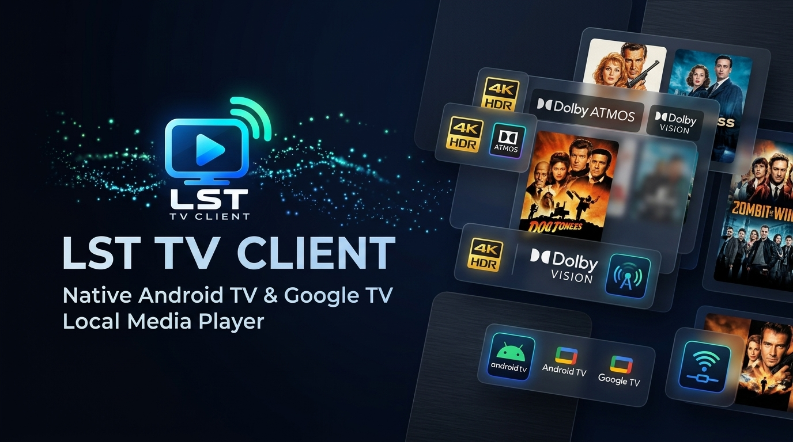
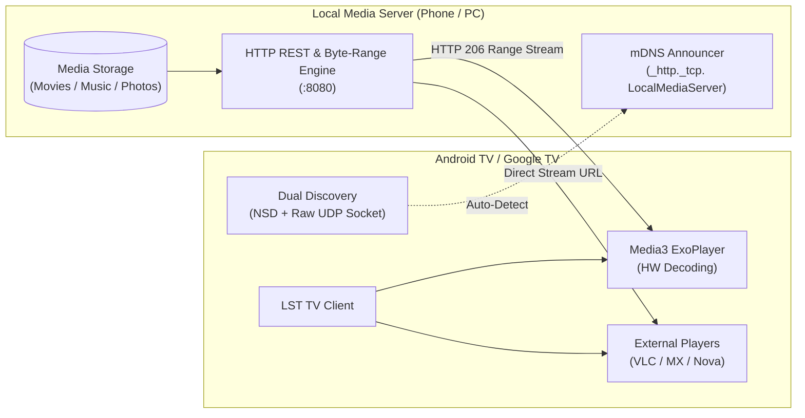

<p align="center">
  
</p>

# LST TV Client — Android TV

<p align="center">
  <strong>A native, high-performance Android TV & Google TV local media streaming client engineered for the 10-foot living room experience.</strong>
</p>

<p align="center">
  <a href="https://developer.android.com/tv"></a>
  <a href="https://kotlinlang.org"></a>
  <a href="https://developer.android.com/media/media3"></a>
  <a href="#prerequisites"></a>
  <a href="#license"></a>
</p>

<p align="center">
  <a href="#-overview">Overview</a> •
  <a href="#-features">Features</a> •
  <a href="#-remote-control-guide">Remote Guide</a> •
  <a href="#-how-it-works">How It Works</a> •
  <a href="#-installation--sideloading">Installation</a> •
  <a href="#-external-players">External Players</a> •
  <a href="#-tech-stack">Tech Stack</a>
</p>

---

<p align="center">
  
</p>

---

## 📺 Overview

**LST TV Client** is a dedicated TV frontend for streaming media directly from an **Android Local Media Server** over your local Wi-Fi or mobile hotspot. 

Unlike typical media apps that require cloud accounts, third-party relays, or heavy server transcoding, LST TV Client communicates directly over local HTTP. It delivers low-latency playback, sub-second random seeking on massive 4K video files, and a fluid 10-foot television user interface completely controlled with standard TV remotes.

### Core Architectural Principles
- **Strictly Client-Only (Zero Overhead)**: The TV app is exclusively a media consumer. It runs no background server services and consumes zero TV storage for media files, keeping your TV snappy.
- **Zero-Configuration Discovery**: Automatically detects servers on your local network using mDNS/NSD with zero setup.
- **Pure D-Pad Experience**: 100% remote-control navigable. Touchscreen dependency is explicitly disabled (`android.hardware.touchscreen = false`).
- **Hardware-Accelerated Streaming**: Built on **AndroidX Media3 (ExoPlayer)** with native HTTP 206 byte-range seeking.

---

## ✨ Features

### 🎬 10-Foot Living Room UI
- **Custom Navigation Rail**: Fast sidebar access to **Home**, **Movies**, **Music**, **Folders & Shares**, and **Server Settings**.
- **Dynamic Hero Spotlight**: Full-screen cinematic backdrop automatically updates with high-resolution artwork as you browse items.
- **Continue Watching Row**: Instant resume bookmarks with visual progress bars and remaining time for in-progress movies and episodes.
- **Hierarchical Folder Explorer**: Full filesystem browsing with real-time breadcrumbs and stack-based remote back navigation.
- **Status HUD**: Integrated top bar featuring live network connectivity status and a digital clock.

### 🔍 Discovery & Connection Management
- **Dual-Engine Auto-Discovery**: Combines Android's native `NsdManager` with an asynchronous raw UDP multicast socket (`TvMdnsScanner`) to bypass aggressive router multicast filtering.
- **On-Screen Remote PIN Pad**: Clean D-pad numeric keypad (`0-9`, `.`, `:`, `Delete`) for quick manual IP address entry without struggling with standard virtual keyboards.
- **Saved Connection Manager**: Store multiple servers, edit IP/ports, view live ping status pills (Online/Offline), and switch between servers in one click.

### ⚡ Video Playback (ExoPlayer Media3)
- **HTTP 206 Byte-Range Streaming**: Enables $O(1)$ random seeking on massive 1080p and 4K MKV, MP4, and WebM files without waiting for file downloads.
- **D-Pad Scrubbing Controls**:
  - **Tap Left / Right**: Instant $\pm 10$ seconds skip with on-screen visual feedback.
  - **Hold Left / Right**: Fast $\pm 30$ seconds progressive scrubbing.
  - **Center / OK**: Toggle Play / Pause and display transport controls.
  - **Up**: Display technical stream HUD (Resolution, Codec, Audio Track, Bitrate).
  - **Down**: Open Audio Track and Subtitle selection dialog.
- **Smart Resume Dialog**: Prompts you to *"Resume from XX:XX"* or *"Start from Beginning"* when opening partially-watched videos.
- **Codec Fallback Prompt**: Detects unsupported hardware codec errors and prompts you to instantly play via an external media player.

### 🎵 Lossless Audio Player
- Dedicated fullscreen player with a rotating vinyl turntable animation.
- Displays track metadata, artist, album, and format (`FLAC 24-bit`, `MP3`, `AAC`, `WAV`, `OGG`).
- Press **D-pad Down** to open the interactive folder queue drawer and select other tracks.

### 🖼️ 4K Photo Slideshow
- Fullscreen picture viewer with 100% black letterboxing.
- Automatic 5-second slideshow timer with smooth crossfade animations.
- Manual remote navigation with Left / Right D-pad controls.

---

## 🎮 Remote Control Guide

| Screen | Remote Button | Action |
|:---|:---|:---|
| **Browse / Home** | **D-pad Left** | Focus the Navigation Rail (Home / Movies / Music / Folders / Settings) |
| | **D-pad Right** | Move into media cards and rows |
| | **D-pad Up / Down** | Scroll through media rows or list items |
| | **OK / Center** | Open selected item, play media, or trigger action |
| | **Back** | Navigate up folder hierarchy / Focus rail / Exit confirmation |
| **Video Player** | **OK / Center** | Toggle Play / Pause & show on-screen controls |
| | **D-pad Right (Tap)** | Skip forward $+10\text{s}$ |
| | **D-pad Right (Hold)** | Fast-forward $+30\text{s}$ |
| | **D-pad Left (Tap)** | Skip backward $-10\text{s}$ |
| | **D-pad Left (Hold)** | Rewind $-30\text{s}$ |
| | **D-pad Up** | Show stream info card (Codec, Resolution, Audio) |
| | **D-pad Down** | Open Subtitle & Audio Track dialog |
| | **Back** | Save resume bookmark and return to browse |
| **Audio Player** | **OK / Center** | Toggle Play / Pause |
| | **D-pad Left / Right** | Skip to Previous / Next track |
| | **D-pad Down** | Open interactive folder playlist drawer |
| | **Back** | Return to browse screen |
| **Photo Viewer** | **OK / Center** | Toggle automatic slideshow (Play / Pause) |
| | **D-pad Left / Right** | Manual Previous / Next image |
| | **Back** | Exit slideshow |

---

## 🏗️ How It Works



---

## 🚀 Installation & Sideloading

### Prerequisites
- **Target Device**: Android TV, Google TV, or Android TV Box running **Android 7.0 (API 24)** or newer.
- **Local Network**: TV and Media Server connected to the same Wi-Fi or hotspot.

---

### Option 1: Install Pre-Built APK (Quickest)

A pre-built debug APK is available directly in this repository: [`LST-TV-Client-debug.apk`](file:///c:/Users/ADMIN/Documents/Env/Local%20media%20sever/TV%20Client/LST-TV-Client-debug.apk).

#### Step 1: Enable Developer Options & Network Debugging on your TV
1. On your TV, navigate to **Settings** > **Device Preferences** > **About**.
2. Scroll to **Build** and press the **OK** button **7 times** until you see *"You are now a developer!"*.
3. Go to **Settings** > **Device Preferences** > **Developer Options**.
4. Enable **USB Debugging** and **Network Debugging** (or Wireless Debugging).
5. Note your TV's IP address (located in **Settings** > **Network & Internet** > your Wi-Fi name).

#### Step 2: Sideload via ADB
From a terminal on your computer connected to the same Wi-Fi network:

```bash
# Connect to your TV (replace with your TV's actual IP)
adb connect 192.168.1.150:5555

# Verify the device is connected
adb devices

# Install the pre-built APK
adb install -r LST-TV-Client-debug.apk
```

---

### Option 2: Build from Source

You can build the project using the included Gradle wrapper:

```bash
# Windows
.\gradlew.bat assembleDebug

# macOS / Linux
./gradlew assembleDebug
```

The output APK will be placed at:
```
app/build/outputs/apk/debug/app-debug.apk
```

Then install via ADB:
```bash
adb install -r app/build/outputs/apk/debug/app-debug.apk
```

---

### Android TV Launcher Banner
Once installed, **LST TV Client** will appear directly in the **Apps** row on your Android TV / Google TV home screen with its official banner:

<p align="center">
  
  <br />
  <em>Official 320x180 Leanback Launcher Banner</em>
</p>

---

## 🍿 External Players

LST TV Client handles standard formats natively (H.264, H.265/HEVC, VP9, AV1, MP4, MKV). For specialized audio formats (TrueHD, DTS-HD Master Audio) or legacy containers (VC-1, MPEG-2), you can launch videos in your preferred external TV player:

- **[VLC for Android](https://play.google.com/store/apps/details?id=org.videolan.vlc)** (`org.videolan.vlc`)
- **[Nova Video Player](https://play.google.com/store/apps/details?id=org.courville.nova)** (`org.courville.nova`)
- **[Just Player](https://play.google.com/store/apps/details?id=com.brouken.player)** (`com.brouken.player`)
- **[MX Player](https://play.google.com/store/apps/details?id=com.mxtech.videoplayer.ad)** (`com.mxtech.videoplayer.ad` / `pro`)
- **[Kodi](https://play.google.com/store/apps/details?id=org.xbmc.kodi)** (`org.xbmc.kodi`)

Simply select any video item and choose **"Open With..."**, or accept the automatic external player fallback if an internal decoding error occurs.

---

## 📡 Server API Specification

LST TV Client connects to servers implementing three simple JSON endpoints:

### 1. Storage Shares
```http
GET /api/shares
```
```json
[
  {
    "id": "share_movies",
    "name": "Movies & Series",
    "uri": "content://storage/Movies",
    "isAccessible": true
  }
]
```

### 2. Media Directory Listing
```http
GET /api/media?shareId={shareId}&path={relativePath}
```
```json
{
  "shareId": "share_movies",
  "shareName": "Movies & Series",
  "currentPath": "SciFi",
  "items": [
    {
      "name": "Interstellar.2014.1080p.mkv",
      "path": "SciFi/Interstellar.2014.1080p.mkv",
      "isDirectory": false,
      "size": 4294967296,
      "mimeType": "video/x-matroska",
      "modified": 1715000000000
    }
  ]
}
```

### 3. Media Streaming (HTTP 206 Byte-Range)
```http
GET /api/stream?shareId={shareId}&path={encodedPath}
```
- **Client Header**: `Range: bytes={start}-{end}`
- **Server Response**: `HTTP/1.1 206 Partial Content` with `Content-Range: bytes {start}-{end}/{total}`

---

## 🛠️ Tech Stack & Architecture

```
com.localserver.tv
├── data
│   ├── api
│   │   ├── MediaServerClient.kt        // OkHttp API client & coroutine dispatchers
│   │   └── ServerApiModels.kt          // DTO models (ShareDto, MediaItemDto, MediaListDto)
│   ├── discovery
│   │   ├── TvNsdDiscoveryManager.kt    // NsdManager scanner with Wifi MulticastLock
│   │   ├── TvMdnsScanner.kt            // Custom async UDP socket mDNS packet scanner
│   │   └── TvMdnsPacket.kt             // Binary mDNS parser for DNS-SD PTR/SRV/A records
│   └── repository
│       ├── MediaRepository.kt          // Cache, category grouping & data aggregation
│       └── ServerPreferences.kt        // DataStore for saved servers, last active & bookmarks
├── ui
│   ├── browse
│   │   ├── MainTvActivity.kt           // Root TV container with rail, hero backdrop & clock
│   │   ├── MainTvFragment.kt           // Leanback BrowseSupportFragment integration
│   │   ├── TvMediaAdapters.kt          // 10-foot media card presenters & list adapters
│   │   ├── MediaItemActionHandler.kt   // Dispatches clicks to internal or external players
│   │   └── ExitConfirmationDialog.kt   // TV-friendly exit confirmation dialog
│   ├── connect
│   │   ├── ServerSelectDialog.kt       // Server selector with live ping & saved list
│   │   └── ManualIpDialog.kt           // D-pad on-screen PIN pad for IP:port entry
│   ├── player
│   │   ├── VideoPlayerActivity.kt      // Fullscreen Media3 ExoPlayer with remote controls
│   │   ├── AudioPlayerActivity.kt      // Fullscreen music player with animated turntable
│   │   ├── ExternalPlayerHelper.kt     // Intent builder for VLC, MX Player, Nova, Just Player, Kodi
│   │   ├── SelectPlayerDialog.kt       // "Open with..." player selection modal
│   │   └── MediaActionDialog.kt        // Action prompt (Play Internal, External, Resume)
│   └── photo
│       └── PhotoSlideshowActivity.kt   // Fullscreen 4K photo viewer with auto-timer
```

| Component | Library / Technology |
|:---|:---|
| **Language** | Kotlin 1.9.24 / JVM 17 |
| **TV UI Framework** | AndroidX Leanback (`1.0.0`) |
| **Media Player** | AndroidX Media3 ExoPlayer (`1.4.1`) + OkHttp DataSource |
| **Networking** | Square OkHttp (`4.12.0`) & Kotlinx Coroutines Android (`1.8.1`) |
| **Serialization** | Kotlinx Serialization JSON (`1.7.3`) |
| **Image Loading** | Coil (`2.7.0`) with TV-tailored bitmap pooling |
| **Local Persistence** | Jetpack DataStore Preferences (`1.1.1`) |

---

## ❓ Troubleshooting

- **Server not discovered automatically?**
  - Some routers or mobile hotspots block multicast packets between wireless devices.
  - Select **Enter Server IP Manually** on the TV screen and input your server's IP and port (e.g. `192.168.43.1:8080`). The app saves this connection for one-click access next time.
- **Audio plays but video is a black screen?**
  - Your TV's hardware decoder may not support the file's video profile (e.g., 10-bit AV1 or high-bitrate VC-1). Click **Open With...** and select **VLC** or **Nova**.
- **Buffering on large 4K files?**
  - Connect your Android TV via 5 GHz Wi-Fi or Ethernet cable to ensure consistent throughput for high-bitrate remuxes.

---

## 📄 License

This project is licensed under the [MIT License](LICENSE).
